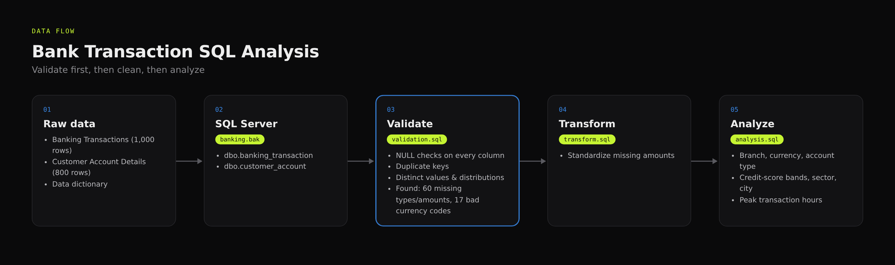
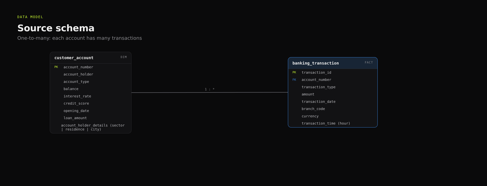
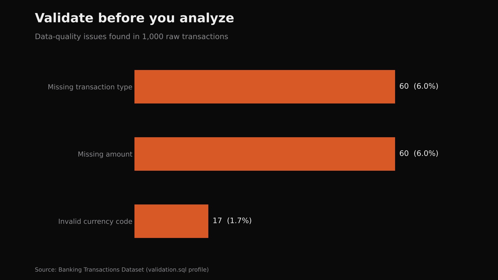
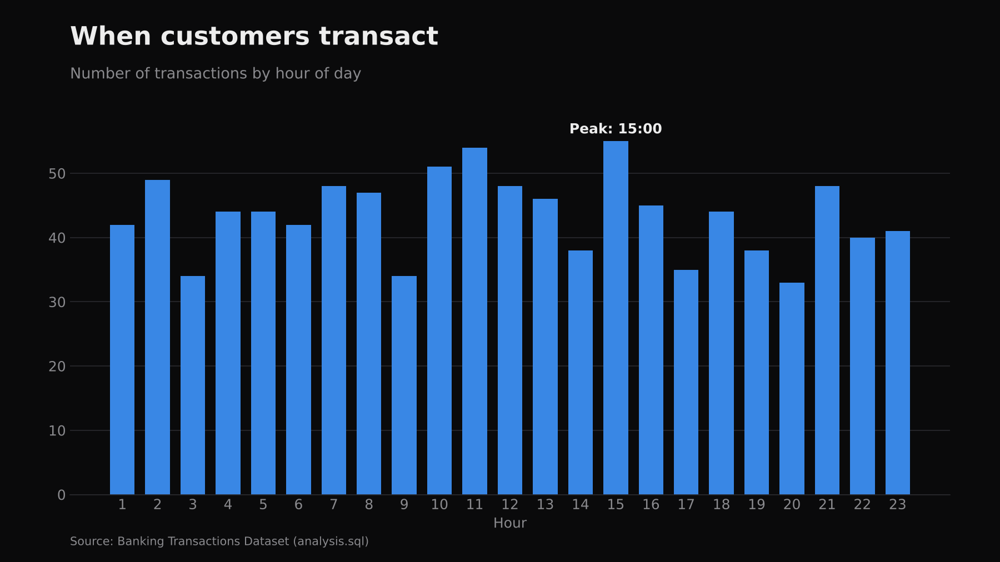
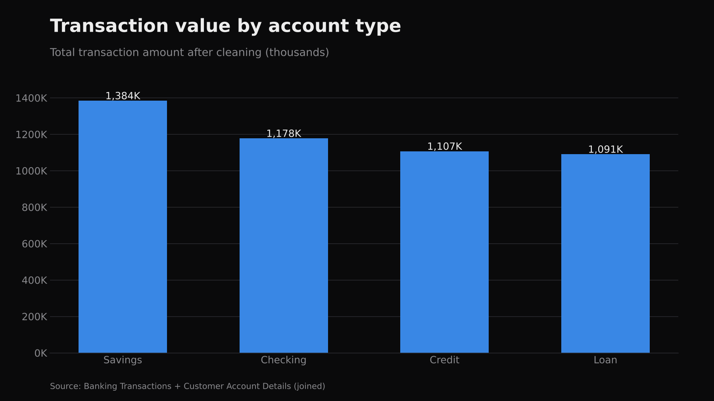
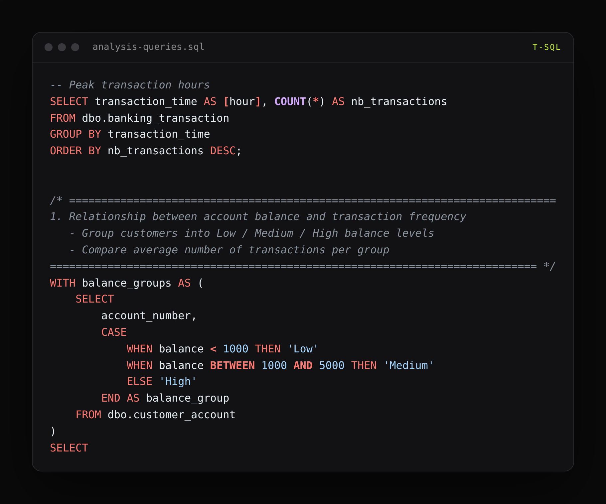
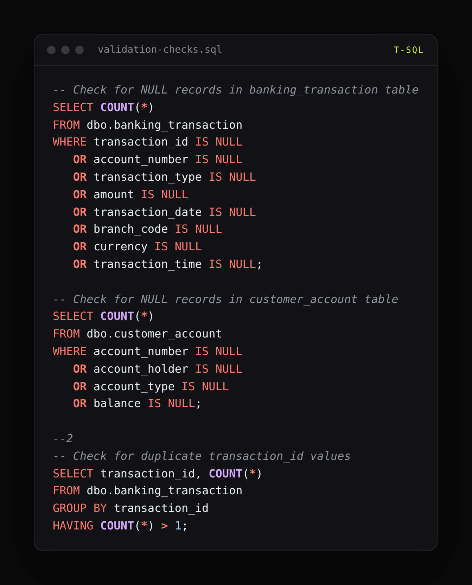

# Bank Transaction SQL Analysis

## Introduction
This project analyzes a retail-banking dataset in SQL Server. It answers questions such as: *Which branches and currencies carry the most activity? How does behavior differ by credit-score band, account type, customer sector, and city? When are the peak transaction hours?*

The workflow mirrors a real analyst engagement: first prove the data can be trusted (validation), fix what is broken (transformation), then analyze.

## Dataset
| Table | Rows | Columns |
|---|---|---|
| `banking_transaction` | 1,000 | transaction_id, account_number, transaction_type, amount, transaction_date, branch_code, currency, transaction_time |
| `customer_account` | 800 | account_number, account_holder, account_type, balance, interest_rate, credit_score, opening_date, loan_amount, account_holder_details |

`account_holder_details` is a semi-structured text field (sector, years of residence, city) that is parsed during analysis. A data dictionary is included in `Data Dictionary.xlsx`.

## Workflow
| Step | Script | What it does |
|---|---|---|
| 1. Validate | `validation.sql` | NULL checks on every column, duplicate-key checks, distinct-value profiling, distributions for categorical columns |
| 2. Transform | `transform.sql` | Standardizes missing transaction amounts |
| 3. Analyze | `analysis.sql` | Volume and value by branch, currency, credit-score range, account type, transaction type, sector, residence length, and city; peak transaction hours |

## How to run
1. Restore `banking.bak` in SQL Server Management Studio, or import the two Excel files as `dbo.banking_transaction` and `dbo.customer_account`.
2. Run `validation.sql`, then `transform.sql`, then `analysis.sql`.

## Skills demonstrated
Data profiling and validation · T-SQL joins, aggregation, and CASE-based bucketing · parsing semi-structured fields · exploratory business analysis

## Gallery

**Data flow**

**Data model**

**Insight: data quality**

**Insight: peak hours**

**Insight: value by account type**

**Code: analysis queries**

**Code: validation checks**

